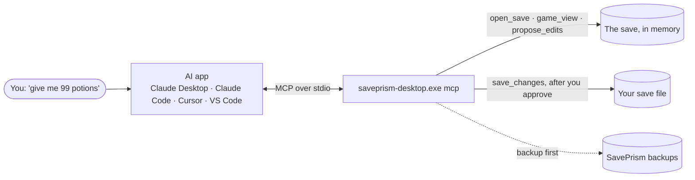
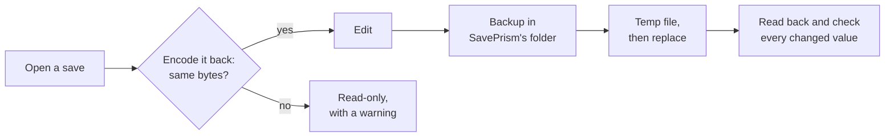

<div align="center">

<picture>
  <source media="(prefers-color-scheme: dark)" srcset="docs/brand/SavePrism-logo-on-dark.png">
  
</picture>

**Save editor for PC games. Runs on your PC: no account, no upload.**

[](#download)
[](LICENSE)
[](#ai-and-mcp)
<br>
[](https://www.rust-lang.org)
[](https://v2.tauri.app)
[](https://react.dev)
[](https://www.typescriptlang.org)
[](https://tailwindcss.com)
[](https://vite.dev)
[](https://pnpm.io)

</div>

SavePrism opens a save from Unity, Unreal Engine, RPG Maker, Ren'Py, Godot and 60+ other formats, lets you change gold,
items, stats and story variables, and writes the file back **in its original format**. Online save editors upload your
file to their server and limit how often you may use them; SavePrism does the same work locally. Before you can edit, it
encodes the save back and checks that every byte comes out the same, so it never writes a file it does not fully
understand. Every save makes a backup first. Your AI app can use it too: SavePrism is an MCP server, so Claude, Cursor or
VS Code can open and edit a save with the same checks.

<div align="center">

**[Download](#download)** · **[Quick start](#quick-start)** · **[AI and MCP](#ai-and-mcp)** ·
**[Report a bug](https://github.com/huseyincancalti/saveprism/issues/new?template=bug_report.yml)** ·
**[Ask for a game](https://github.com/huseyincancalti/saveprism/issues/new?template=game_support.yml)** ·
**[Share a theme](https://github.com/huseyincancalti/saveprism/discussions/categories/community-themes)** ·
**[Add a language](https://github.com/huseyincancalti/saveprism/issues/new?template=add_language.yml)**

<br>

<picture>
  <source media="(prefers-color-scheme: dark)" srcset="docs/images/demo-dark.gif">
  
</picture>

</div>

## Download

Pick the file for your system from **[Releases](https://github.com/huseyincancalti/saveprism/releases/latest)**:

| System | File |
|---|---|
| Windows 10 and 11 | [SavePrism_0.9.0_x64-setup.exe](https://github.com/huseyincancalti/saveprism/releases/download/v0.9.0/SavePrism_0.9.0_x64-setup.exe) |
| macOS (Intel and Apple silicon) | [SavePrism_0.9.0_universal.dmg](https://github.com/huseyincancalti/saveprism/releases/download/v0.9.0/SavePrism_0.9.0_universal.dmg) |
| Linux | [SavePrism_0.9.0_amd64.AppImage](https://github.com/huseyincancalti/saveprism/releases/download/v0.9.0/SavePrism_0.9.0_amd64.AppImage) or [SavePrism_0.9.0_amd64.deb](https://github.com/huseyincancalti/saveprism/releases/download/v0.9.0/SavePrism_0.9.0_amd64.deb) |

Windows is tested by hand. The Linux and macOS builds are new and not yet tried on real machines; if something is off,
please [open an issue](https://github.com/huseyincancalti/saveprism/issues/new/choose).

- **Windows:** the installer is not code-signed yet, so SmartScreen may say "Windows protected your PC": choose
  **More info → Run anyway**. It installs for your Windows user only, so it does not ask for administrator rights.
  SavePrism needs Microsoft Edge WebView2; Windows 10 and 11 already have it, and the installer fetches it if missing.
- **macOS:** the app is not notarized by Apple, so the first start says macOS cannot check it. Open **System Settings →
  Privacy & Security** and press **Open Anyway**, or run `xattr -cr /Applications/SavePrism.app` once.
- **Linux:** run `chmod +x SavePrism_*.AppImage` and start the file, or install the `.deb`.
- SavePrism tells you when a new version is out and installs it when you say so (**Check for updates** in Settings →
  About looks right away). On Linux this works for the AppImage; with the `.deb`, install the new `.deb`.

## Quick start

1. Open SavePrism and drop a save on the window, or press **Open file**. You can also right-click a save in Explorer and
   choose **Decode with SavePrism** (Windows only; on Windows 11 under **Show more options**), or paste a save code
   with **Ctrl+V**.
2. Not sure where the game keeps its saves? **Where is my save?** on the start screen lists the usual folders by engine.
3. Change values. Every change shows as *old → new*, and **Ctrl+Z** takes it back.
4. Save. By default **Save as…** writes a new file and leaves the original as it was. **Overwrite current file** (in the
   save menu, or the main button if you pick it in Settings) makes a backup first, then replaces the file in one step.
   Every write is read back and checked; **Backups** in the bottom bar puts an older copy back.

### Build from source

| You need | Version |
|---|---|
| A 64-bit system | Windows 10 or 11, macOS, or Linux |
| [Node.js](https://nodejs.org) | 22 or newer |
| [pnpm](https://pnpm.io) | 11 (`corepack enable` picks the version from `package.json`) |
| [Rust](https://rustup.rs) | 1.99 or newer, stable (the MSVC toolchain on Windows) |
| [Tauri prerequisites](https://v2.tauri.app/start/prerequisites/) | Windows: Visual Studio Build Tools with "Desktop development with C++" and WebView2. macOS: Xcode Command Line Tools. Linux: WebKitGTK 4.1 and the other packages listed there |

```bash
git clone https://github.com/huseyincancalti/saveprism.git
cd saveprism
pnpm install
pnpm dev      # the app, with hot reload
pnpm build --no-sign    # installers in target/release/bundle/ (the setup exe in nsis/ on Windows)
```

There is nothing to configure: no `.env` file, no API keys, no accounts. `--no-sign` skips the update signature:
without it, `pnpm build` still makes the installer but then stops with "A public key has been found, but no private
key". Releases (maintainer only) come from the `release` workflow (**Actions → release → Run workflow**): it builds all
three systems, signs the update files with the `TAURI_SIGNING_PRIVATE_KEY` secret and uploads them with `latest.json` to
a draft release tagged `v<version>`. `bash scripts/release/build.sh` makes the same signed Windows build locally.

## AI and MCP

SavePrism does not call any AI model and has no API keys. It works with the AI app you already use, in two ways:

| | Ask AI | MCP server |
|---|---|---|
| **Works with** | any AI chat | AI apps that run tools: Claude Desktop, Claude Code, Cursor, VS Code and others |
| **How** | **Ask AI** on a list copies its values with their limits. Paste them into the chat, ask, then make the changes in SavePrism. | The AI app starts `saveprism-desktop.exe mcp` and talks to it over standard input and output. No window, no network port. |
| **Who edits** | you | the AI, with the same round-trip check and backups as the app; it asks you before it saves |



### Connect your AI app

Open **Settings → AI connection**, pick your AI app and press **Copy setup**. The copied entry already has the real path
of your SavePrism program:

```json
{
  "mcpServers": {
    "saveprism": {
      "command": "C:\\Program Files\\SavePrism\\saveprism-desktop.exe",
      "args": ["mcp"]
    }
  }
}
```

- **Claude Desktop:** Settings → Developer → Edit Config, paste the entry into `mcpServers` of
  `claude_desktop_config.json`, restart Claude Desktop.
- **Claude Code:** `claude mcp add saveprism -- "C:\Program Files\SavePrism\saveprism-desktop.exe" mcp`
- **Cursor:** Customize → MCP, or `%USERPROFILE%\.cursor\mcp.json`.
- **VS Code:** `.vscode/mcp.json` under `servers` with `"type": "stdio"` (Copy setup gives you this shape).

<div align="center">
<picture>
  <source media="(prefers-color-scheme: dark)" srcset="docs/images/ai-dark.png">
  
</picture>
</div>

### What the AI can do

| Tool | What it does | Writes files |
|---|---|---|
| `save_locations` | Lists the usual save folders per engine and which ones exist on this PC | no |
| `open_save` | Opens a save and runs the round-trip check; keys of encrypted Easy Save 3 and Terraria files are found in the game's own files (or given as a game folder or password) | no |
| `open_code`, `copy_code` | Opens a save code pasted into the chat and hands the edited code back, every changed value checked | no |
| `game_view`, `list_values`, `search_values`, `field_info` | Reads the app's view (RPG Maker sections with names, story variables, the Values list), the full tree, search results and each value's limits | no |
| `compare_saves` | Lists what differs between the open save and another save, with the names the app shows | no |
| `set_data_folder` | Reads names from an RPG Maker data folder | no |
| `propose_edits`, `add_value`, `add_inventory`, `remove_value` | Changes values in memory; everything is checked first, and on any error nothing changes | no |
| `pending_changes`, `undo`, `discard_changes` | Shows every change (old → new) or takes changes back | no |
| `save_changes` | Backup, replace in one step, read back; only the open file or a new file next to it | **yes** |
| `list_backups`, `restore_backup` | Lists the open save's backups and puts one back (the current file is backed up first) | restore: **yes** |

The two writing tools are marked as destructive, so AI apps ask you before they run. Backups follow the folder and
counts chosen in Settings. The AI app may send the values it reads to its own online model: keep that in mind for
saves with player names or account ids. Details: [docs/ai.md](docs/ai.md).

## Features

### Edit like a player

- **Sections, not a byte dump:** RPG Maker gold, characters, items, weapons, armors, variables and switches with the
  names from the game's own data folder; Twine story variables; Unreal and Palworld properties; Satisfactory
  inventories with item names; The Witcher 3 Gwent collection and decks.
- **Edits that fit the file:** numbers keep their size and range, true/false values are a choice, text stays in the
  file's encoding. An edit the format cannot hold is refused before it can reach the file.
- **Lists that scale:** search, filters and pages on every list, add and remove entries where the format allows,
  **Set all** for RPG Maker lists, undo and redo, and a JSON view with **Apply** and **Export .json**.

<table>
  <tr>
    <td width="50%">
      <picture>
        <source media="(prefers-color-scheme: dark)" srcset="docs/images/editor-dark.png">
        
      </picture>
    </td>
    <td width="50%">
      <picture>
        <source media="(prefers-color-scheme: dark)" srcset="docs/images/changes-dark.png">
        
      </picture>
    </td>
  </tr>
</table>

### Safe by design



- Saves are read as data and never run: no Python unpickling, no Ruby eval, no .NET BinaryFormatter deserialization.
- Backups live in SavePrism's own folder, never next to the save: 1 to 50 per save, for up to 30 days. **Backups**
  restores one and backs up the current file first.
- A file that changed on disk after you opened it is never overwritten (`SP-APP-023`): save under another name or open it
  again.
- Parsers limit sizes and depths and are fuzz-tested, because a save from the internet is untrusted input.
- Still keep your own copy of a save you care about: a game update can change its format.

<div align="center">
<picture>
  <source media="(prefers-color-scheme: dark)" srcset="docs/images/backups-dark.png">
  
</picture>
</div>

### Find, compare, unlock

- **Where is my save?** Search by game or engine and see where saves usually live.
- **Compare with another save:** what is only here, only there, or different between two saves.
- **Encrypted and packed saves:** Easy Save 3 passwords and the Terraria player key are found in the game's own files on
  your PC (with a note of where they came from); simple XOR is undone automatically; gzip, zstd, xz, LZ4, Brotli, zip,
  tar and other layers are found by content, whatever the file extension.
- **Save codes:** paste a code (SugarCube, Base64, hex), edit it, and **Copy code** gives the new one.
- **Unknown file?** **Copy file report** gives a short report (extension, size, first bytes and a hash; never the file or
  its path) to paste into a [game request](https://github.com/huseyincancalti/saveprism/issues/new?template=game_support.yml).

<table>
  <tr>
    <td width="50%">
      <picture>
        <source media="(prefers-color-scheme: dark)" srcset="docs/images/where-dark.png">
        
      </picture>
    </td>
    <td width="50%">
      <picture>
        <source media="(prefers-color-scheme: dark)" srcset="docs/images/compare-dark.png">
        
      </picture>
    </td>
  </tr>
</table>

### Make it yours

- Light, dark or the Windows setting; an app color (six presets, your Windows accent, monochrome or any color); text size
  from 80 to 140 %; your own colors for changed values, the accent and errors.
- A background pattern, or your own photo behind frosted glass (blur, fade and card opacity).
- Keyboard shortcuts you can change; English, Turkish, Spanish, Russian, Japanese and Simplified Chinese.
- **Theme files:** export your look, share it in
  [Community themes](https://github.com/huseyincancalti/saveprism/discussions/categories/community-themes), import
  someone else's. A theme file is data only and is checked before anything changes.

<table>
  <tr>
    <td width="50%">
      <picture>
        <source media="(prefers-color-scheme: dark)" srcset="docs/images/appearance-dark.png">
        
      </picture>
    </td>
    <td width="50%">
      <picture>
        <source media="(prefers-color-scheme: dark)" srcset="docs/images/start-dark.png">
        
      </picture>
    </td>
  </tr>
</table>

## Supported formats

The most asked:

| Engine or format | Files | What you can edit |
|---|---|---|
| RPG Maker MV / MZ | `.rpgsave`, `.rmmzsave` | gold, characters, items, weapons, armors, variables, switches, with names from the game's `data` folder |
| RPG Maker XP / VX / VX Ace | `.rxdata`, `.rvdata`, `.rvdata2` | the same sections, names from the `Data` folder |
| RPG Maker 2000 / 2003 | `.lsd` | the same sections, names from `RPG_RT.ldb`; Shift-JIS or Windows-1252 text (also from `RPG_RT.ini`) |
| Unity · Easy Save 3 | `.es3` | plain, GZip and AES (password needed) |
| Unity · PlayerPrefs | registry export `.reg` | ints, floats, strings |
| Unity / .NET BinaryFormatter | `.dat`, RAGS `.rsv` | values (read as data, never run) |
| Unreal Engine | `.sav` (GVAS) | values |
| Palworld | `.sav` (PlZ) | values (PlM/Oodle not supported) |
| Satisfactory | `.sav` (1.x, header 13/14) | header numbers, scalar properties and inventory item counts (`NumItems`); strings, maps, sets and unknown object data stay read-only |
| Slime Rancher 2 | `<date>_<game>_<slot>.sav` | newbucks; vacpack and plot slot counts with item names; everything else stays read-only |
| Godot | ConfigFile text (`.cfg`, `.ini`, `.save`), `store_var` binary, JSON, text resources (`.tres`), binary resources (`.res`, `RSRC` and `RSCC`) | values (references, typed containers, strings in binary resources and encrypted files stay read-only or are refused) |
| Ren'Py | `.save`, `persistent` | store variables (read as data, never run) |
| Twine · SugarCube 2 | save files and save codes | story variables |
| Terraria | player `.plr` (key from the game's own `Terraria.exe`), world `.wld` | name, difficulty, play time, life/mana, inventory; world name, seed, size, ids and flags (tiles and the rest read-only) |
| Grand Theft Auto III | `GTA3sf*.b` (classic PC, 201,820 bytes) | save name, island, in-game time, money, wanted and chaos level |
| Grand Theft Auto IV | `SGTA4xx` | last mission, in-game date and time, money, health, armour, maximum health/armour, wanted and chaos level |
| Grand Theft Auto: San Andreas | `GTASAsf*.b` (classic PC, 202,752 bytes) | save name, in-game time, money, health, armour, maximum health/armour |
| The Witcher 3 | `.sav` | orens, item quantities |
| JSON and text | `.json`, zip- or gzip-packed JSON | values; add and remove entries |

<details>
<summary><b>Every other format</b> (RPG Maker relatives, visual novel engines, BioWare, FromSoftware, consoles and emulators, databases, data formats)</summary>

| Engine or format | Files | What you can edit |
|---|---|---|
| Wolf RPG Editor | `.sav` (not encrypted) | switches, variables, the variable database |
| Adventure Game Studio | `agssave.000` ... `agssave.999` | description, engine and game title; 3.x script globals read-only |
| NScripter / ONScripter | `save*.dat`, `global.sav` / `gloval.sav` | global numbers and Shift-JIS strings; the slot description (the slot body stays read-only) |
| AliceSoft System 3.x / 4 | `.asd`, `.as2`, `.asdbak` | System 3.x numbers and fixed-length Shift-JIS strings; System 4 globals (numbers, booleans, floats, fixed-length strings); encrypted System 4 saves are read-only |
| Artemis Engine | `save/*.dat`, `saveg.dat` | detected (magic, version and the decompressed body); the body is read-only because its inner layout has no public description |
| Emuera / eraMaker | binary `saveNN.sav`, `global.sav`, `var_*.dat`, `chara_*.dat` | variables and character arrays by name; text-format saves are not opened |
| Unity · Odin Serializer | Odin binary (`BinaryDataWriter`) saves | primitives, strings and arrays (type tables and references read-only) |
| Unity · Adventure Creator | save files in the persistent data folder (JSON, XML and Base64 BinaryFormatter parts joined by `||`) | values in every part; one part is rewritten at a time |
| Unity · Pixel Crushers Save System | `save<N>.dat` (JSON `SavedGameData`) | saver data as nested JSON; Dialogue System Lua variables and quests (read as data, never run) |
| TyranoScript | `.sav` | values |
| Naninovel | save slots | custom variables |
| QSP | `.sav` | values; Windows-1251 and KOI8-R legacy saves |
| KiriKiri / KAG | `.ksd`, `.kdt` | dictionary and array values; plain, scrambled (`FE FE` mode 0/1) and zlib-compressed text |
| GameMaker | INI, JSON, `ds_map_write` and `ds_list_write` hex dumps (magic 402/403 maps, 302/303 lists) | INI/JSON values; map keys, list items, scalar values, 1D and legacy 2D arrays |
| Pixel Game Maker MV | `play_LOADFILE*.json` | values (plain JSON) |
| Flash | `.sol` (AMF0 / AMF3) | values |
| Pokémon Gen 3 | `.sav` | money, coins, bag, party EXP / IVs / EVs / stats |
| BioWare GFF V3.2 | `.bic`, `.ifo`, `.git`, `.are`, `.uti`, `.utc`, `.dlg`, `.jrl` (Neverwinter Nights, KOTOR, Jade Empire, The Witcher) | numbers and same-length strings; structs and lists stay read-only |
| BioWare ERF containers | `.erf`, `.mod`, `.hak`, `.sav` (Neverwinter Nights, KOTOR `SAVEGAME.sav`) | one resource inside; the others stay byte-identical |
| Dragon Age: Origins / II GFF V4 | `.das` | values shown read-only (the V4 layout is not rewritten) |
| Java serialization | object streams | values (read as data, never run) |
| SQLite | database saves | table values |
| LevelDB | `.ldb`, `.sst` (tables) and `.log` (write-ahead log) | keys and values as text or hex; read-only |
| RocksDB | `.sst` (block-based tables) | keys and values; read-only |
| LiteDB | `.db` (LiteDB 4 and 5 datafiles) | collection documents; fixed-size integers, doubles and booleans are editable |
| MessagePack | `.msgpack`, `.msgp` | values (extension payloads are read-only) |
| Protocol Buffers | `.pb`, `.pbf`, `.protobuf`, `.protobin`, `.bytes` | field numbers, varints, fixed values and strings; nested message lengths are recomputed (groups read-only) |
| Bitser (LÖVE) | `.dat`, `.save`, `.bin` by content | numbers, booleans and strings; tables, references, resources and class data stay read-only |
| SCS `.sii` (ETS2 / ATS) | `.sii`, `game.sii`, `info.sii`, `profile.sii` | unit attributes as text; binary `BSII` is read-only; encrypted `ScsC` opens with the `g_save_format` hint |
| CBOR | `.cbor` | values (tags stay as read-only wrappers) |
| BSON | `.bson` | doubles, strings, ints and booleans (other types read-only) |
| Minecraft NBT | `.dat`, `.nbt` (Java big-endian, Bedrock little-endian, gzip) | values and numeric array elements |
| Minecraft Java region | `.mca`, `.mcr` | chunk NBT values; opaque, LZ4 and external `.mcc` chunks stay read-only |
| Compressed saves | bzip2, Zstandard, xz, LZMA-alone, LZip, LZ4 frame, Brotli, raw deflate, LZF (raw and `ZV` blocks) — found by content, any extension | the same formats inside any of these layers |
| XOR-obfuscated saves | single-byte or repeating key up to 32 bytes | the format inside; the key is recovered from the inner format automatically |
| Tar archives | `.tar` | one payload entry, the rest of the archive kept byte-identical |
| PS1 memory cards | `.mcr`, `.mcd`, `.mem`, `.gme` | one save file from the card; XOR checksums recomputed and title/icon frames kept |
| PS2 memory cards | `.ps2` | one save file from the card's FAT tree; ECC recomputed on the pages that change |
| PS2 save exports | `.psu` | one file from the export; `.max` (LZARI) is not opened |
| SharkPort GBA snapshots | `.sps`, `.xps` | the raw GBA save; title, date, comment and checksum kept |
| FromSoftware BND4 containers | `.sl2`, `.bnd` (Dark Souls II/III, Sekiro, Elden Ring) | one entry inside (raw or DCX zlib); the other entries stay byte-identical; encrypted files are not opened |
| Blizzard MPQ archives | `.mpq`, `.SC2Save`, `.w3z` | one entry (zlib/bzip2 sectors are decompressed); uncompressed entries are editable, compressed or encrypted ones read-only |
| Brickadia `.brz` archives | `.brz` | one file from the archive; stored files are editable when no other file shares them |
| Brickadia saves | `.brs` | the map name, author and description; brick data stays read-only |
| Pasted hex / percent / Base64 codes | text | decoded when the text spells a format SavePrism knows; the Base64URL alphabet and optional padding are kept |
| XML | `.xml` | element text and attribute values (comments, CDATA and declarations stay read-only) |
| INI / CFG | `.ini`, `.cfg`, `.conf` | section values |
| Java properties | `.properties` | values (Java escapes and line continuations) |
| TOML | `.toml` | strings, integers, floats and booleans |
| YAML | `.yaml`, `.yml` | plain, quoted and literal-block scalars (anchors and tags stay read-only) |
| CSV | `.csv` | cells (quoting kept) |
| Text encodings | every text format above | UTF-8/16/32 (with or without BOM), Shift-JIS, GB18030, CP949, Windows-1252; an edit the encoding cannot hold is refused |
| Property lists | `.plist` (XML and binary) | XML strings, integers, reals and booleans; binary lists open read-only |
| Snes9x snapshots | `.000`-`.009`, `.frz` (plain or gzip) | the save-RAM (`SRA`) block as raw bytes; every other block is read-only |
| RetroArch save states | `.state`, `.state1` ... (uncompressed `RASTATE`) | blocks shown read-only; RZIP-compressed states open with a hint to turn off state compression |
| RetroArch battery saves | `.srm` | raw save RAM (fixed size) |

</details>

A file that does not pass the round-trip check opens read-only with a warning. Easy Save 2 files are not opened: Moodkie
publishes no byte-level layout for them, so SavePrism does not guess. Made for single-player saves of games you own;
online games, anti-cheat and DRM are out of scope.

## Where SavePrism keeps things

| What | Where | Change it in |
|---|---|---|
| Settings (theme, colors, shortcuts, language) | inside the app | Settings |
| Backups | `%LOCALAPPDATA%\SavePrism\backups\` | Settings → Saving & backups → Backup folder |
| Pasted save codes (newest 10) | `%LOCALAPPDATA%\SavePrism\pasted\` | Settings → Saving & backups → App folder |
| Your background photo | `%LOCALAPPDATA%\SavePrism\background\` | Settings → Saving & backups → App folder |
| Found keys, with where they came from | `%LOCALAPPDATA%\SavePrism\keys.json` | next to the backup folder |
| Theme files | wherever you export them (`*.saveprism-theme.json`) | |

The paths above are for Windows. On macOS the same folders are in `~/Library/Application Support/SavePrism/`, on
Linux in `~/.local/share/saveprism/` (or `$XDG_DATA_HOME/saveprism/`). On Windows the installer puts the program in
`%LOCALAPPDATA%\SavePrism\` as well; uninstalling removes only the program files: backups, pasted codes, keys and your
photo stay.

The only network request SavePrism makes is the version check to GitHub releases (at start, which you can turn off in
Settings → General, and when you press **Check for updates** in Settings → About). Save data is never sent.

## Command line

The `saveprism` tool (`crates/saveprism-cli`; `cargo run -p saveprism-cli -- <command>`) detects every format above;
`decode` and `encode` work for JSON, RPG Maker MV/MZ, Easy Save 3 and GVAS.

```bash
saveprism inspect <save>                                   # detected format and round-trip result
saveprism decode <save> -o save.json                       # save → JSON + save.json.recipe.toml
saveprism encode save.json --recipe <recipe> -o <save>     # JSON → save (backup first)
saveprism keys try <save> --candidates <list.txt>          # find the password of an encrypted ES3 save
```

## Themes and languages

- **A theme** is a small JSON file: export it in **Settings → Appearance → Theme files**, change the name, colors, app
  color, text size or background, and share it in
  [Community themes](https://github.com/huseyincancalti/saveprism/discussions/categories/community-themes). The file
  format and how the colors work: [docs/themes.md](docs/themes.md).
- **A language** is one file, `apps/desktop/locales/<code>.json`: add it and the app lists the language by itself. A
  test fails on any missing key or lost placeholder, so you cannot miss one. Steps:
  [CONTRIBUTING.md](CONTRIBUTING.md#add-a-language). Not a coder? Open an
  [Add a language](https://github.com/huseyincancalti/saveprism/issues/new?template=add_language.yml) request.

<details>
<summary><b>Repository structure</b></summary>

```text
apps/desktop/                 the Windows app (Tauri 2)
├── src/                      React + TypeScript UI
│   ├── editor/               the save views: sections, lists, values, JSON, compare
│   ├── shell/                start screen, header, Settings, dialogs, appearance, shortcuts
│   ├── i18n/                 loads the language files, language menu
│   └── theme/                light, dark and system theme
├── src-tauri/src/
│   ├── session/              open, edit, save, backups, key finder, save locations
│   └── mcp/                  the MCP server (saveprism-desktop.exe mcp)
└── locales/<code>.json       one file per language: name, flag, UI text, What's new
crates/
├── saveprism-core/           value tree, format detection, round-trip guard, limits, backup + atomic write
├── saveprism-codecs/         one module per format (rpgmaker, es3, gvas, renpy, godot, ...)
└── saveprism-cli/            the saveprism command line tool
fuzz/                         cargo-fuzz targets for the parsers
fixtures/                     synthetic test saves, expected output, fixture generators
docs/                         ai.md, themes.md, architecture, research notes, brand assets
scripts/                      third-party notices generator, CDP helpers for checks
```

</details>

## Contributing

Bug reports, game requests, translations, themes and code are all welcome. [CONTRIBUTING.md](CONTRIBUTING.md) has the
setup, the checks to run and the rules (clean room, no GPL-family dependencies, parsers that never panic).

```bash
cargo fmt --all
cargo clippy --workspace --all-targets -- -D warnings
cargo test --workspace
pnpm typecheck && pnpm lint && pnpm test
```

| I want to | Go to |
|---|---|
| Report something that does not work | [Bug report](https://github.com/huseyincancalti/saveprism/issues/new?template=bug_report.yml) |
| Ask for a game or save format | [Game or format support](https://github.com/huseyincancalti/saveprism/issues/new?template=game_support.yml) |
| Suggest a feature or an AI/MCP tool | [Feature request](https://github.com/huseyincancalti/saveprism/issues/new?template=feature_request.yml) |
| Translate SavePrism | [Add a language](https://github.com/huseyincancalti/saveprism/issues/new?template=add_language.yml) |
| Share a theme | [Community themes](https://github.com/huseyincancalti/saveprism/discussions/categories/community-themes) |
| Report a security problem | [SECURITY.md](SECURITY.md) (privately, not as an issue) |

## License

[MIT](LICENSE). Third-party licenses: [THIRD_PARTY_NOTICES.md](THIRD_PARTY_NOTICES.md). What SavePrism is and is not for:
[DISCLAIMER.md](DISCLAIMER.md). SavePrism's own code is written from public documentation and its own tests; no code,
tables or keys are copied from closed-source tools.

<br>

<div align="center">
<sub>Made by <a href="https://github.com/huseyincancalti">Hüseyin Can ÇALTI</a>. If SavePrism saved your run, a ⭐ helps other players find it.</sub>
</div>
